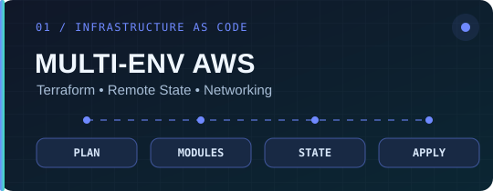
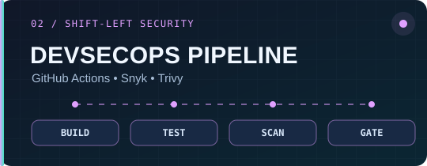
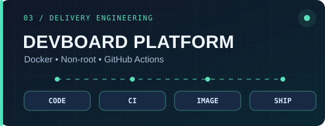
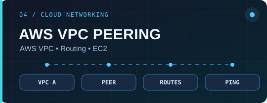

  

  
  
  

  

  
  

## About me

I'm a UK-based **DevOps Engineer with over two years of professional experience** across cloud infrastructure, deployment automation and platform operations. I've worked with teams at **DRIFE**, **Carrier Abound** and the **University of Hertfordshire**, combining day-to-day engineering work with practical research into secure delivery.

I focus on **AWS, Terraform, Kubernetes and CI/CD**, with a growing interest in **site reliability engineering**, observability and automating operational work. I enjoy troubleshooting issues, understanding why systems fail and making the next deployment easier to operate.

## What I bring to a team

| Area | Hands-on experience |
| :--- | :--- |
| **Cloud and infrastructure** | AWS infrastructure, networking, IAM, Terraform modules and environment configuration |
| **Containers and orchestration** | Docker, Kubernetes on EKS, Helm, workload configuration and troubleshooting |
| **Delivery automation** | Jenkins and GitHub Actions pipelines, build optimisation and deployment checks |
| **Reliability and observability** | CloudWatch, Prometheus, Grafana, Loki, service logs, metrics and incident investigation |
| **Security in CI/CD** | SonarCloud, Snyk, Trivy, container hardening and automated vulnerability checks |

## Featured engineering projects

  
  
  
  

<strong>Explore the implementation and results</strong>

| Project | Engineering focus |
| :--- | :--- |
| **[Multi-Environment AWS Infrastructure](https://github.com/riyan-ahmed/terraform-aws-multi-environment)** | Terraform networking module reused across dev, staging and production, with EC2, S3 remote state, separate state keys and state locking. |
| **[Lean DevSecOps Pipeline](https://github.com/riyan-ahmed/lean-devsecops-pipeline)** | GitHub Actions, SonarCloud, Snyk, Trivy, SARIF reporting and enforced security gates for Java delivery. |
| **[DevBoard](https://github.com/riyan-ahmed/devboard)** | Added containerisation and CI/CD to a teaching application using React, Go and PostgreSQL. Implemented non-root images and health checks; reduced the backend image from 34 MB to 26 MB in project testing. |
| **[AWS VPC Peering Lab](https://github.com/riyan-ahmed/aws-vpc-peering-project)** | Built and tested private connectivity between two AWS VPCs using public/private subnets, route tables, EC2 and security groups. Validated ICMP traffic across peering. |

## Professional experience

- **DRIFE | Associate Cloud Developer (Nov 2022 – Jul 2023), DevOps Engineer (Jul 2023 – Jan 2024):** Supported AWS EKS workloads, Jenkins pipelines, Kubernetes troubleshooting, reviewed infrastructure changes and release verification.
- **Carrier Abound | DevOps Engineer (Mar – Aug 2024):** Worked with Terraform across environments, CI/CD workflows, container builds and operational documentation.
- **University of Hertfordshire | Research Assistant (Jul 2025 – Jul 2026):** Built and evaluated automated DevSecOps checks for Java applications, including static analysis, dependency scanning, container scanning and security reporting.

## Education

**MSc Advanced Computer Science (Extended)** | University of Hertfordshire, 2026

## Technical toolkit

**Cloud & IaC**

**Containers & delivery**

**Observability, security & scripting**

## GitHub activity

  

## Currently building

I'm extending **[SkillPulse: GitHub Actions and Kubernetes](https://github.com/riyan-ahmed/github-actions-kubernetes-masterclass/tree/feature/advanced-devops)**, a fork of a training application, with additional CI improvements, security scanning and Kubernetes operations experiments. This is **work in progress**, with the focus on reliability, GitOps and safer operational workflows.

---

  <strong>Interested in cloud platforms, infrastructure automation or reliability engineering?</strong> 
  <a href="https://www.linkedin.com/in/riyan-ahmed-devops/">Let's connect on LinkedIn</a>
  &nbsp;·&nbsp;
  <a href="mailto:Riyanahmed.a1@gmail.com">Get in touch by email</a>

